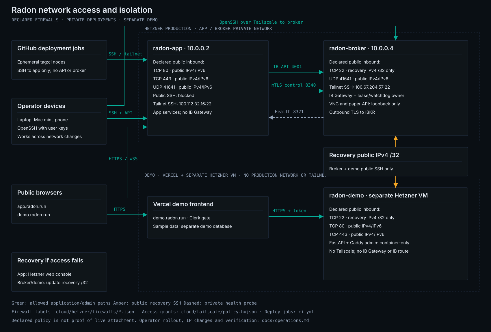

# SPOF host split — operator runbook



## Deployed topology and access

The app/broker split and the private CI cutover are deployed. The graph is
reproducible from [`tools/render_network_topology.py`](../tools/render_network_topology.py);
its public-inbound labels come from [`cloud/hetzner/firewalls/`](../cloud/hetzner/firewalls/).
Run `python3 tools/render_network_topology.py` after a source change, and
`python3 tools/render_network_topology.py --check` to detect a stale SVG.
The graph describes reviewed configuration; it cannot prove live attachment.

- GitHub's three host jobs join as ephemeral `tag:ci` nodes and reach the app's
  OpenSSH port over Tailscale. That role cannot reach broker, ops or API ports.
- Operator devices use OpenSSH over Tailscale to app/broker, and the app's
  direct FastAPI port for cloud-thin development. This is ordinary key-based
  SSH over the private network, not Tailscale SSH authentication.
- The app has no public SSH rule. Broker/demo public SSH accepts only the
  configured recovery IPv4 `/32`; demo has no Tailscale enrollment.
- App to broker trading uses the Hetzner private network; Gateway control uses
  the separate mTLS path documented below. Broker VNC and the paper API bind
  loopback; VNC requires an SSH tunnel to the broker.
- The demo frontend is on Vercel and its Caddy/FastAPI backend is on a separate
  Hetzner VM. HTTPS between them is intentional. Demo has no production
  private-network connection, tailnet path or IB Gateway.

The [network-trust runbook](operations.md#network-trust-ops-plane-step-2)
owns installed firewall boundaries, recovery-IP rotation, console recovery,
and before/after access checks. It also distinguishes active provider rules
from a declared but inactive host UFW ruleset. The
[external-service owner](external-services.md) owns third-party prerequisites.

## Historical split migration reference

The Phase 0/0B/1 recipes below describe initial provisioning, not routine
maintenance of the deployed split. Do not replay them to change a firewall or
repair a private-network connection. Use the current operations runbook first.
A fresh combined-host installation still defaults `RADON_HOST_ROLE=combined`;
the deployed hosts explicitly use `app` and `broker`.

### Initial combined-host compatibility

- Tailscale 4001 bind is `${IB_GATEWAY_TAILSCALE_BIND:-100.112.32.16}`.
- `hhlev` / `hyad` / `vixts` join `auto-sync-units.txt`.
- `refresh-control-plane-privileged` is in sudoers (needs one bootstrap).
- Relay and monitor are no longer `PartOf=` Gateway. A Gateway 2FA restart
  no longer cascade-stops the app plane.
- `RADON_HOST_ROLE` unset means `combined` (this box owns Gateway). Set
  `app` only at the Phase 1 cut: the app role refuses every local Gateway
  mutation including 2FA recovery (`services.py`,
  `ib-gateway-control.sh refuse_app_role_mutation`, `Ib2faControls.tsx`
  `ownsGatewayLifecycle`) and proxies Force 2FA / Stop / Start to the
  broker over mTLS instead. Without the `RADON_IB_REMOTE_*` client vars
  the admin Gateway controls go read-only with no error.

`llm-index` (drift-allowlisted, not installed) and `mktnews`
(manifest-pinned, installed) stay off auto-sync. Control-plane timers (`db-backup`, `refresh`, `portfolio-sync`,
`drift-audit`, …) stay off auto-sync.

### Phase 0: initial backup and recovery preparation

1. Confirm backups. Repo has no record.

   ```bash
   hcloud server describe <current-server> -o json | jq '.public_net, .backup_window, .datacenter'
   ```

   If `backup_window` is empty: enable Hetzner automated backups (20% of
   server price, 7 daily slots). They do not survive server deletion.

2. Named snapshot at a known-green SHA, after a green deploy:

   ```bash
   hcloud server create-image --type snapshot --description "radon-green-<sha>" <server>
   ```

   Ashburn snapshots stay in Ashburn. Not off-site.

3. Copy `/etc/radon/env` to B2 under a tight prefix. Do not put it in git.
   Preserve the mode on restore: `check-env.py` requires `0600` or `0640`
   (canonical `0640` `root:radon`, so the service account reads but cannot
   rewrite).

4. Restore drill, under 20 minutes, off RTH:

   - Snapshot.
   - Power off the live server (or create a *new* server from the snapshot
     and keep the original off).
   - Boot replacement.
   - One IBKR Mobile tap.
   - `curl -sS http://127.0.0.1:8321/health` → `auth_state=authenticated`.
   - Old VM stays off. Two Gateways, same username, one dies.

5. Optional: set `IB_GATEWAY_TAILSCALE_BIND` in `/etc/radon/env` if the
   tailnet IP is no longer `100.112.32.16`. Then `radon-ib-gateway-control
   restart` (2FA).

### Phase 0B: initial privileged bootstrap

The commit that adds `refresh-control-plane-privileged` cannot auto-apply
that sudoers line. After merge, before the next CI deploy:

```bash
# as root; converges on the GitHub main tip via root's own clone
/usr/local/sbin/radon-deploy-root sync-control-plane
```

Do not restart Gateway. Re-run CI for the same SHA if the in-flight deploy
refused preflight. After this, helper/sudoers/polkit edits deploy without
root SSH.

### Phase 1: app/broker split provisioning

Create, in the same Hetzner location and a spread placement group, Hetzner Cloud
Network `radon-private` `10.0.0.0/16` (app `10.0.0.2`, broker `10.0.0.4`).
Small CX. Tailscale + private net. FastAPI trusts `10.0.0.0/16` only for
the broker watchdog's `GET /health` probe (`is_private_net_probe`,
`scripts/api/auth.py`); it is not in the global server-to-server bypass, so
a private-net peer still needs a Clerk JWT or API key for orders, admin and
exec. Not all RFC1918: `172.16.0.0/12` is `docker0` territory and stays
untrusted. `check-env.py` accepts any private v4 for
`IB_GATEWAY_HOST`, so a non-`10.0/16` network deploys green and then every
private-net probe is silently unauthenticated.

Clerk key rotation must remain immediately discoverable on both hosts.
The FastAPI and hosted MCP JWKS clients set PyJWT 2.15's
`cooldown_duration=0`, preserving Radon's existing per-kid negative caches
and bounded lookups instead of imposing a global refresh delay across kids.

Broker VM:

- `RADON_HOST_ROLE=broker`
- `IB_GATEWAY_HOST=127.0.0.1`
- `IB_GATEWAY_TAILSCALE_BIND=<new 100.x>`
- Add a compose private-net bind for `10.x:4001` (not in this SHA; add
  when the 10.x exists).
- Own control-plane bootstrap. Gateway + helper + lease + watchdog only.
- Watchdog `HEALTH_URL=http://10.0.0.2:8321/health`. `/health` is
  trust-scoped: only a `10.0.0.0/16`, trusted tailnet, or loopback peer
  without forwarding headers gets `auth_state`. The tailnet half is
  `RADON_TRUSTED_TAILNET_PEERS` once `RADON_TAILNET_TRUST_MODE=enforce`
  (`scripts/api/auth.py`); the `10.0.0.0/16` probe scope does not change. A probe via `app.radon.run` reads
  `{"status":"ok"}` and the watchdog goes blind.
- Secrets subset: TWS user/pass, VNC, session policy. Not `UW_TOKEN`. The
  Gateway container's only `env_file` is `/etc/radon/ib-gateway/gateway.env`
  (root-only file in a root-only directory), built from the host env by
  `/usr/local/sbin/radon-ib-gateway-credential migrate`, which copies only
  the allowlisted Gateway names (`GATEWAY_ENV_KEYS`). `radon-docker-gw`
  pins it for `compose-up`/`compose-down` and keeps `/etc/radon/env` for
  interpolation and `config-check`. Re-run `migrate` after changing a
  Gateway setting (for example `TRADING_MODE`) in `/etc/radon/env`; it keeps
  a rotated password.

App VM (current box):

- `RADON_HOST_ROLE=app`
- `IB_GATEWAY_HOST=10.0.0.4` (private net, not `100.x`, not public)
- Uninstall Gateway units **and** `/usr/local/bin/radon-ib-gateway-control`.
  FastAPI treats helper-exists as ownership. Leave it and boot starts a
  second Gateway.
- Cut complete: `systemctl is-enabled radon-ib-gateway` is not-found;
  `docker ps` has no `ib-gateway`.
- `check-env.py` refuses a public, CGNAT, or DNS `IB_GATEWAY_HOST` on the
  app role. It does not check that the address is inside `10.0.0.0/16`.
- `check-env.py` pins `RADON_REQUIRE_OPERATOR_ALLOWLIST` to the exact value
  `"1"` in `PRODUCTION_INVARIANTS`: enforcement points compare `==="1"`, so
  any other truthy spelling would silently disable the fail-closed gate.

Move window is off RTH plus one Mobile tap on the broker. App deploy must
leave `auth_state=authenticated` on 4001.

Operator commands after the cut:

- App: `ssh root@radon-app radon {start|stop|restart|status}`
  App-plane only. Does not cycle Gateway.
- Broker: `ssh root@<broker> radon {start|stop|restart|status}`
  Gateway via `radon-ib-gateway-control`. Does not require radon-health.
- App admin Force 2FA / Stop / Start Gateway proxies over mTLS to
  `https://10.0.0.4:8340` (`scripts/ib_gateway_remote/serve.py`). On the
  app role the Gateway status row always comes from the broker; a local
  `radon-ib-gateway.service` row from `radon-control` (a leftover pre-split
  unit) is dropped so it cannot shadow it and disarm the controls. Setup:
  1. Broker: `cloud/scripts/ib-gateway-remote-certs.sh` writes the CA,
     server, and client pairs under `/etc/radon/ib-remote`. Copy `ca.pem`,
     `client.pem`, `client-key.pem` to the app host at the same paths.
  2. App `/etc/radon/env`: set `RADON_IB_REMOTE_URL`, `RADON_IB_REMOTE_CA`,
     `RADON_IB_REMOTE_CLIENT_CERT`, `RADON_IB_REMOTE_CLIENT_KEY` (block in
     `cloud/.env.example`). Then `radon restart` on the app: the API
     container mounts `/etc/radon/ib-remote` read-only only if the
     directory exists when the unit starts (`radon-app-runtime.sh`).
  Rotation (REL-178/R-496): the pair is 825-day self-signed. Re-run the
  mint script on the broker before expiry and re-copy the three files to the
  app host, then restart `radon-ib-gateway-remote` (broker) and `radon-api`
  (app). Expiry is surfaced as `ib_remote_cert_days_left` on the broker
  `/healthz`, `ib_gateway.remote.cert_days_left` on the app `/health`, and
  the ib-watchdog health row warns under 30 days / pages under 7.
  3. Broker: `systemctl enable --now radon-ib-gateway-remote.service`.
     `RADON_IB_REMOTE_ALLOW` is host addresses only (`10.0.0.2`); the
     daemon refuses to start on a subnet. `RADON_IB_REMOTE_CLIENT_NAMES` is
     the second half of the perimeter — the client-certificate CN / DNS SAN
     allowlist, default `radon-app`, matching the `DNS:radon-app` SAN the
     mint script writes. An empty value is a `ConfigError` at startup, not a
     silent open door; set it only if you mint a client cert under a
     different name. Bind is `10.0.0.4`, never `0.0.0.0`. 8340 and 4001
     from `10.0.0.2` only is the broker ufw set (`cloud/scripts/host-firewall.sh
     --role broker`); a Hetzner Cloud Firewall cannot express it because it
     filters the public interface only (`cloud/hetzner/firewalls/`, runbook in
     operations.md).
  Verify from the app host, no Gateway side effect:
  `curl --cacert /etc/radon/ib-remote/ca.pem --cert /etc/radon/ib-remote/client.pem --key /etc/radon/ib-remote/client-key.pem https://10.0.0.4:8340/healthz`
  → `{"ok":true,"service":"ib-gateway-remote"}`.
  Then `/status` must report `"state": "running"` (or `stopped`), never
  `"state": "unknown", "returncode": 2`. The daemon runs as `radon`, which
  left group docker (2026-09-04), so `ib-gateway-control` reaches the
  container only through `sudo -n /usr/local/sbin/radon-docker-gw`. The unit
  therefore carries neither `NoNewPrivileges=yes` nor an empty
  `CapabilityBoundingSet=`: either refuses that setuid hop, every verb
  answers `unknown` rc=2, the API row reads `active_state=unknown`, and the
  operator UI disables every Gateway control (2026-10-22). Privilege is
  bounded by the exact verb list in `sudoers.d/radon-ops`, not by systemd;
  `ProtectSystem=strict` and `PrivateTmp` stay. Pinned by
  `cloud/tests/test_systemd_services.py::TestIBGatewayRemote`.
  Certificates expire 825 days after minting (`-days 825` in the script).
  The proxy's status ladder (`scripts/api/services.py`,
  `scripts/ib_gateway_remote/serve.py`) discriminates the failure:
  `504` (`REMOTE_UNREACHABLE_RC`) the daemon was not reachable at all —
  down, firewalled, or wrong `RADON_IB_REMOTE_URL`; `502`
  (`REMOTE_BAD_REPLY_RC`) it answered but not with a usable reply, which is
  where an expired or untrusted certificate lands; `403` the peer address is
  not in `RADON_IB_REMOTE_ALLOW` (`source not allowlisted`) or the client
  certificate's CN/DNS SAN is not in `RADON_IB_REMOTE_CLIENT_NAMES`
  (`client certificate not allowlisted`); `409` the request was refused, not
  failed — a held 2FA lease, the 60s per-verb cooldown, or (for `start` and
  `restart`) an IBKR login throttle the watchdog recorded in
  `/var/lib/radon/ib-watchdog-state.json` (quiet period in
  `scripts/utils/ib_login_throttle.py`; the detail names the UTC time a login
  is allowed again), with the reason in `detail`. Expiry also shows the Gateway row as `load_state=remote`,
  `active_state=unknown`. For 502/403, re-run the mint script and steps 1-3;
  Gateway itself is untouched. A 409 from a held 2FA lease or the 60s cooldown
  needs no action but time. A 409 from an IBKR login throttle means do not log
  in until the UTC time in `detail`. During market-data hours the watchdog
  retries then. Outside those hours, one app-path restart after that time is
  the recovery. Broker-local `radon restart` and a broker-host
  `POST /ib/restart` call the helper directly and are another login. See
  [Gate 6](ib-gateway-recovery.md#6-watchdog-login-throttle-hold-2026-09-26).
  Reversal: `systemctl disable --now radon-ib-gateway-remote.service` on
  the broker and unset `RADON_IB_REMOTE_URL` on the app (controls go
  read-only, no error).
- IB Gateway password rotation (`POST /rotate-password`). Change the
  password on the IBKR website first, then save it in Profile, Credentials,
  IB Gateway login, and confirm. FastAPI (`PUT /credentials/ib_gateway`)
  posts `{password, userid?, actor}` once over the same mTLS channel
  (`ROTATE_TIMEOUT_S=150`; Next route 165s; Caddy `@credential_mutate` 200s;
  no retry in the rotation path). The daemon validates the value (no `'`,
  control characters including U+0085, line separators U+2028/U+2029, edge
  whitespace or trailing `\`; 1 to 256 characters), then:

  | Broker reply | Meaning | App store | App reply |
  |---|---|---|---|
  | 409 `ROTATION_IN_PROGRESS` / `LOGIN_BLOCKED` (`cooldown`, `lease`) | refused before any write | untouched | 409, nothing saved |
  | 202 `RESTART_DEFERRED` | written; operator hold, IBKR login throttle, or helper rc 73/74/75 deferred the restart | written | 200 `deferred` |
  | 200 | written, Gateway recreated once (one push) | written | 200 `applied` |
  | 502 `RESTART_FAILED` | written, helper restart failed (not retried) | written | 200 `restart_failed` |
  | 502 `WRITE_FAILED` | writer refused | untouched | 502, nothing saved |
  | 401/403/405/413 with no `written` | daemon refused before any write (peer or cert-CN allowlist, method, size) | untouched | 502 `GATEWAY_WRITE_FAILED`, nothing saved |
  | none: connect or TLS handshake failed | the broker never got the request | untouched | 503 `GATEWAY_BROKER_UNREACHABLE`, nothing saved |
  | 502 `WRITE_UNKNOWN`, or none after the request was sent (read timeout, reset), or a reply with no `written` | unknown | untouched | 504 `GATEWAY_ROTATION_UNKNOWN`: do not resubmit |

  Resolving a 504 unknown outcome, on the broker as root:
  `journalctl -u radon-ib-gateway-remote --since "-15 min" | grep rotate-password`
  shows the daemon's status line for the POST, and
  `stat -c '%y %n' /etc/radon/ib-gateway/gateway.env /etc/radon/ib-gateway/gateway.env.prev`
  shows whether the writer ran (both rewritten at the save time). Written:
  the Gateway reads the new password and the app store still holds the old
  one; check the Gateway on `/admin`, then save once more only in a quiet
  window (another restart and push), or leave the store until the next
  rotation. Not written: save again after the 60s cooldown.

  A wrong password after `applied` (no IBKR Mobile push arrives) is not
  retried by the rotation, but the IB watchdog relaunches a Gateway whose API
  port never comes up (`restart-preheld`, stuck-2FA and API-hang backoff),
  and every relaunch reads the same `gateway.env`: each one is another failed
  IBKR login, toward IBC's "Too many failed login attempts" throttle. Set the
  operator hold at once (`radon ib release` on the broker, or Hold on
  `/admin`), confirm the password on the IBKR website, save the correct one
  (it writes and defers, 202), then `radon ib resume` for one login.

  The write goes through `sudo -n /usr/local/sbin/radon-ib-gateway-credential write`
  with the values as JSON on stdin (never argv). Sudoers line, exact:
  `radon ALL=(root) NOPASSWD: /usr/local/sbin/radon-ib-gateway-credential write`.
  `migrate`, `prune-root-env` and `rollback` are root-only. The writer
  replaces only the `TWS_PASSWORD` (and `TWS_USERID`) line atomically and
  keeps the previous file as a root-only `gateway.env.prev`. The unit opens
  `ReadWritePaths=-/etc/radon/ib-gateway` because its sudo children inherit
  the read-only `/etc`. Do not add a `log_input` sudo Default for radon: it
  records stdin. Rollback of a bad password: `radon-ib-gateway-credential
  rollback` (helps only if the IBKR password was reverted too), then one
  `radon-ib-gateway-control restart`.
  The one-time broker cutover is
  [Gateway env split cutover](#gateway-env-split-cutover-one-time).
- The API image has no `systemctl` or `sudo`. App-plane rows and actions on
  `/admin` go through `radon-control.service`, a host daemon on a unix
  socket that only the radon-api container mounts (contract:
  [operations.md, Host control socket](operations.md#host-control-socket-radon-controlservice)).
  `/admin/services` then reports `supported=true` and
  `status_source=host-control`, with real unit descriptions, uptimes and
  per-unit `allowed_actions`. When the socket is absent or the daemon is
  down, rows fall back to the host health daemon (`127.0.0.1:8330/status`,
  `status_source=host-health`, `can_control=false`) and the panel is
  read-only. Gateway status stays on the remote ladder above.
- Host-local service actions take the provisioned
  `/var/lib/radon-lock/deploy.lock` and then the retained compatibility lock.
  A held lock refuses the action before systemd mutation. App-container actions
  continue through the host control socket; Gateway actions continue through
  the broker path above. Lock provisioning does not restart Gateway.
- App `Restart All Services` stays app-plane. It does not cycle Gateway.
  Through the control socket it is answered first and runs detached, since
  it restarts radon-api itself.

Do not put the broker in Falkenstein. Do not run two Gateways. Do not
restore a broker snapshot beside a live broker. Do not start a standby
FastAPI pool against a live Gateway.

## Gateway env split cutover (one time)

The release controller (`scripts/unattended_release.py`, every 5 minutes)
runs `radon-deploy-root sync-control-plane <main_sha>` as root on the broker
soon after the main deploy goes green, so the new `radon-docker-gw` and
`/usr/local/sbin/radon-ib-gateway-credential` land without anyone acting.
Until `migrate` has run, `radon-docker-gw` keeps the old container env
(`/etc/radon/env`) with a WARNING on stderr, as long as nothing sits at
`/etc/radon/ib-gateway/gateway.env` and `/etc/radon/env` still carries
`TWS_PASSWORD`. Password rotation fails closed in that window (`WRITE_FAILED`,
nothing saved). Broker sync installs no sudoers, so the writer's sudoers line
is a manual step. Run as root on the broker, in this order, in a quiet window
(no trading, operator ready for one IBKR Mobile push):

1. Confirm the sync landed: `ls -l /usr/local/sbin/radon-ib-gateway-credential`
   (root:root 0755) and `grep -c use_gateway_env_file /usr/local/sbin/radon-docker-gw`.
2. Build the Gateway env file (names only are printed; review any WARNING
   line of names not copied): `/usr/local/sbin/radon-ib-gateway-credential migrate`.
   Check `stat -c '%U:%G %a' /etc/radon/ib-gateway /etc/radon/ib-gateway/gateway.env`
   reads `root:root 700` and `root:root 600`.
3. Restart the broker daemon AFTER step 2:
   `systemctl restart radon-ib-gateway-remote.service`. Its
   `ReadWritePaths=-/etc/radon/ib-gateway` binds only if the directory
   existed when the unit started; skipped, every rotation fails with the
   writer hitting a read-only `/etc` (`WRITE_FAILED`).
4. Install the writer's sudoers line. Copy `cloud/config/sudoers.d/radon-ops`
   from the merged commit to `/root/radon-ops.new`, then
   `diff -u /etc/sudoers.d/radon-ops /root/radon-ops.new` (expect only the
   "IB Gateway password rotation (broker)" stanza),
   `visudo -cf /root/radon-ops.new`, and
   `install -o root -g root -m 0440 /root/radon-ops.new /etc/sudoers.d/radon-ops`.
   Verify: `sudo -l -U radon | grep radon-ib-gateway-credential` lists exactly
   `/usr/local/sbin/radon-ib-gateway-credential write`. Skipped, rotations
   fail with `sudo: a password is required` (`WRITE_FAILED`).
5. `radon-docker-gw config-check` exits 0.
6. Recreate once so the container picks up `gateway.env` (env_file applies at
   create only): `radon-ib-gateway-control restart`, then approve the push.
7. Audit the container env by name only:
   `docker inspect -f '{{range .Config.Env}}{{println .}}{{end}}' ib-gateway | cut -d= -f1 | sort`.
   It must hold only `GATEWAY_ENV_KEYS` names plus what the image and the
   compose `environment:` block set; no `UW_TOKEN`, `TURSO_*`, `CLERK_*`,
   `PUSHOVER_*`, `MENTHORQ_*`, `B2_*` or `ANTHROPIC_*`.
8. Only after the Gateway logged in on the new file (API port up on
   `/admin`): `/usr/local/sbin/radon-ib-gateway-credential prune-root-env`.
   It removes `TWS_PASSWORD` / `TWS_USERID` from `/etc/radon/env` and keeps
   a root-only backup of the previous file beside it,
   `env.pre-ib-gateway-split`. From then on a missing
   `gateway.env` makes `compose-up` exit 78 instead of falling back.

Rollback before step 8: `rm /etc/radon/ib-gateway/gateway.env` and one
`radon-ib-gateway-control restart` brings the old env back through the
fallback. After step 8: restore `/etc/radon/env` from
`/etc/radon/env.pre-ib-gateway-split` first.

## IBKR operator hold

The broker daemon (`scripts/ib_gateway_remote/serve.py`) answers `start` and
`restart` with `423 OPERATOR_HOLD`, without running the helper, while
`radon ib release` holds the Gateway out of the operator's shared IBKR
login. Its `/status` payload carries `operator_hold`. `stop` and
`reset-lease` stay open. `POST /hold` (JSON `reason`, `actor`) writes the
hold and runs the helper `stop`, with no cooldown. `POST /unhold` removes it and
runs one `start` through the usual cooldown and login-throttle gates. The app
reaches both through FastAPI `POST /ib/operator-hold` (operator JWT). Runbook:
`docs/ib-gateway-recovery.md`.

## Never

- Kubernetes / Compose-as-OS / hot second IBKR username as HA.
- Tailscale as the production order path.
- `hcloud server rebuild` of broker while the original is still logged in.

## Done when

App deploy does not 2FA. App VM kill does not kill the IB session. Broker
restore is exclusive. Unit-only and privileged helper edits need no
standing root session.
